<p align="center">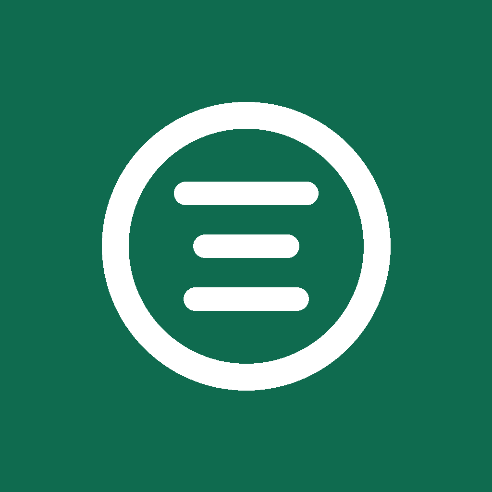</p>

<h1 align="center">FET Family Expenses Tracker</h1>

**A shared monthly expense tracker for families.** Private, works offline, and keeps your data on your own device or in your own Google account. One app, the same features on phones, tablets, foldables and desktops.

[](https://github.com/SailHighSea/sailhighsea-fea/actions/workflows/build.yml)

<p align="center">
  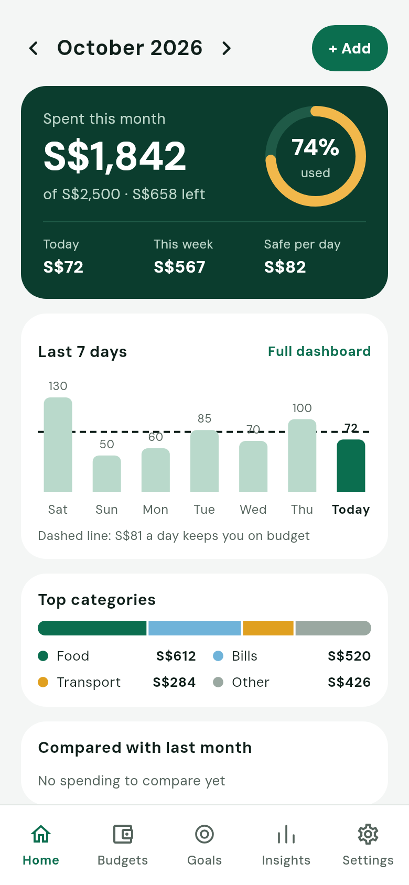
  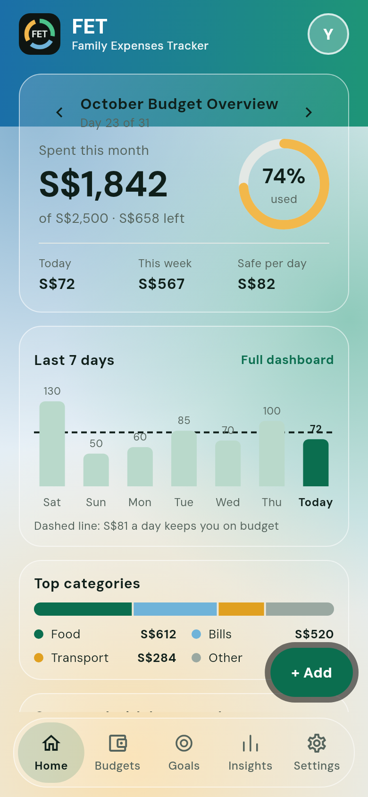
  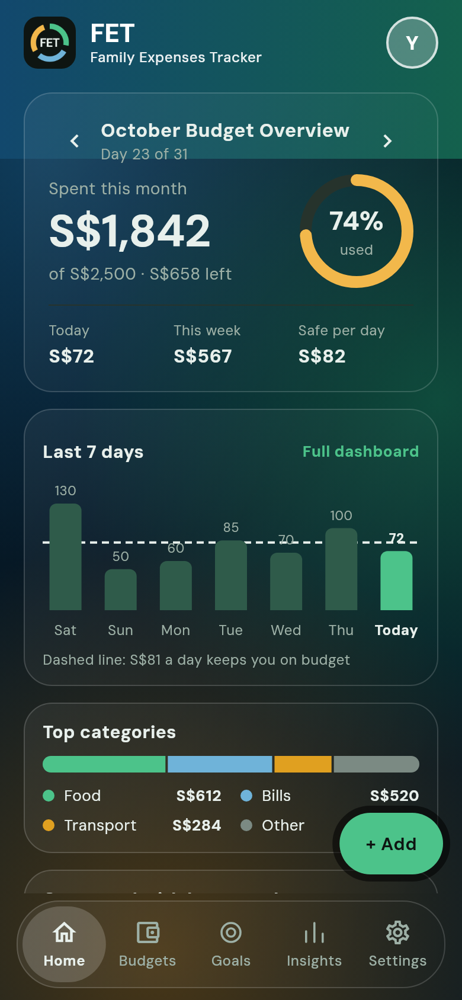
</p>

## What it does

- **Add expenses in seconds.** Type an amount, pick a category, done. Scan a receipt, or import a bank or card statement from a sheet, CSV, Excel, PDF or even a photo. The app reads the date, description and amount, guesses the category, shows you a table to check first, and remembers your choices for next time.
- **No double entries.** If an imported row looks like an expense you already have, or two family members both wrote down the same purchase, the app shows both and asks "Is this a duplicate?" before anything is added or removed.
- **A clear month at a glance.** A gradient header with the logo and your name, and an overview card with spent, left, today, this week and a safe amount per day. Swipe the card to change month. Below: a daily chart, top categories, a comparison with last month and, for families, who spent what.
- **Budgets, bills and goals.** A budget for the month and for each category, bills with reminders, and savings goals that show when they will be done.
- **Income and savings.** Enter your monthly income and what you hold in savings to see what is left to save, where your income goes, your savings rate over six months, and whether your goals fit.
- **Made for families.** Share one household through your own Google Drive (or a server). Organisers and members have different rights, and each person sees only what the organiser allows.
- **Your look.** Choose **Standard** or **Glass** (see-through cards and a floating glass bottom bar) on the welcome screen or in Settings. Ten colour themes in Light, Dark and Pure black, a gradient or classic Home header, and your own colour, gradient or picture behind the app (six pictures come with it).
- **Your categories.** Your own icons (48) and colours (26) for every category, with 38 ready-made ones such as Groceries, Rent, Fuel and Pets.
- **Private by design.** Works offline. No ads and no tracking. An app lock, and backups saved wherever you like that can be protected with a password (encrypted with AES-256) and hold your theme and settings too. Nothing is shared with the app developer.
- **On every screen.** Phones, tablets, foldables, Windows, Mac and Linux, with a layout that follows the window width, so every feature is the same everywhere. Desktop windows get a title bar in the theme's colours.

## Screenshots

| | | |
|:--:|:--:|:--:|
| 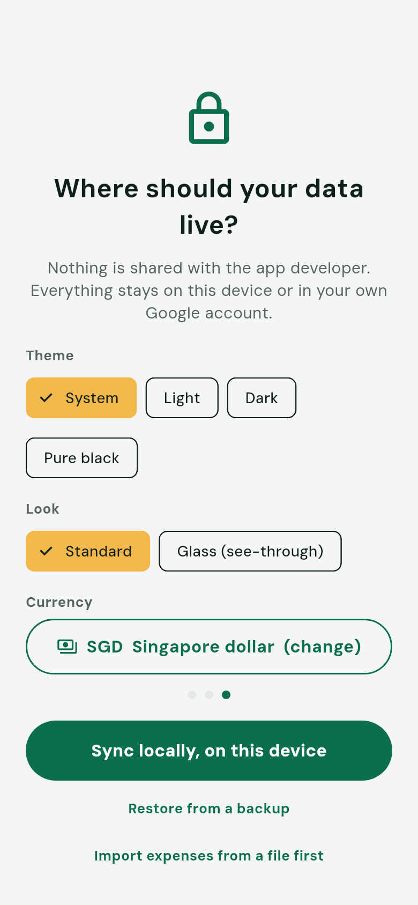<br>Welcome: where your data lives, theme, look and currency | 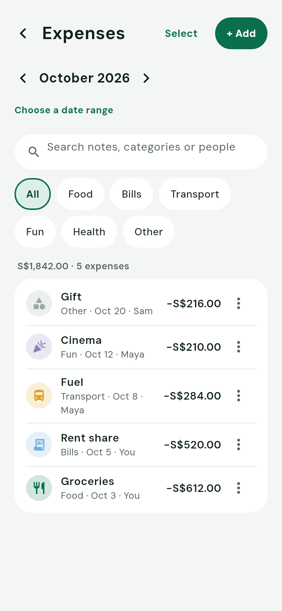<br>Expenses | 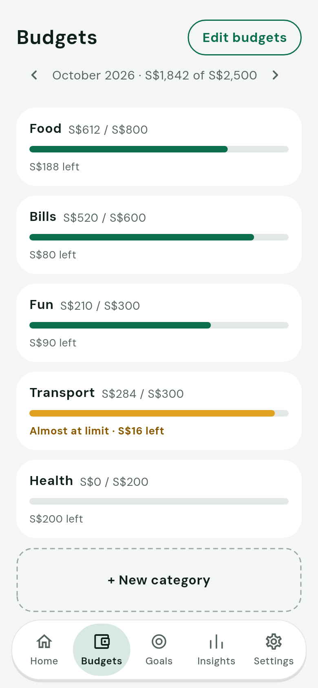<br>Budgets |
| 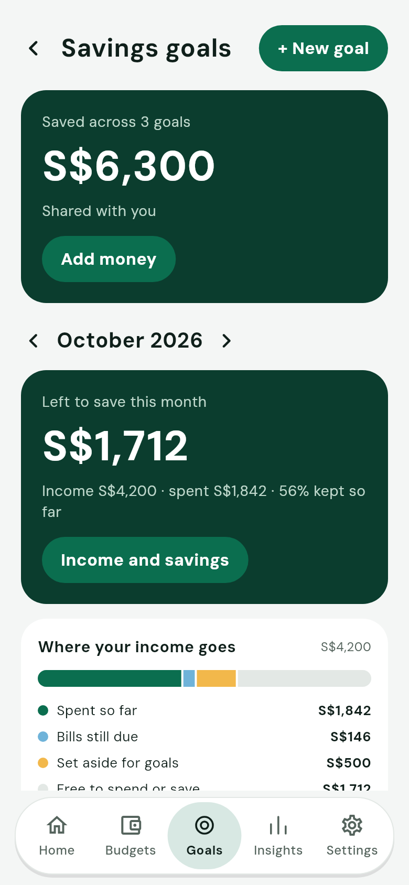<br>Goals and savings | 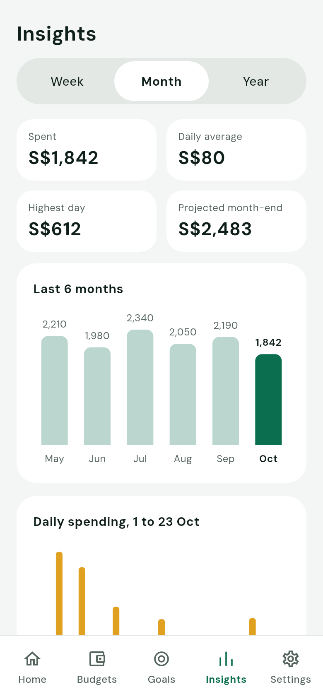<br>Insights | 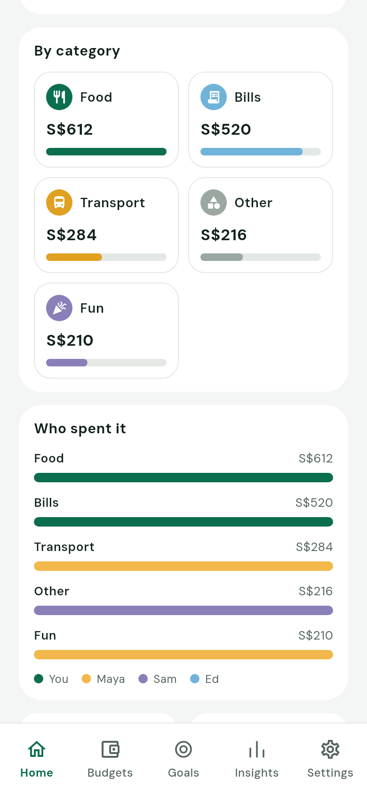<br>Who spent it (families) |
| 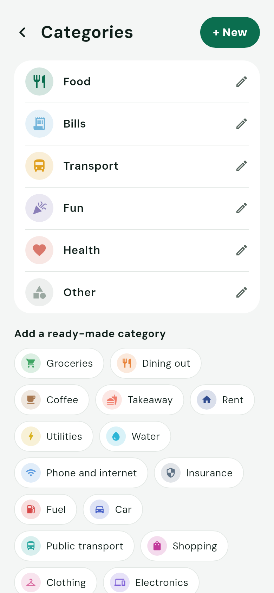<br>Categories with icons and colours | 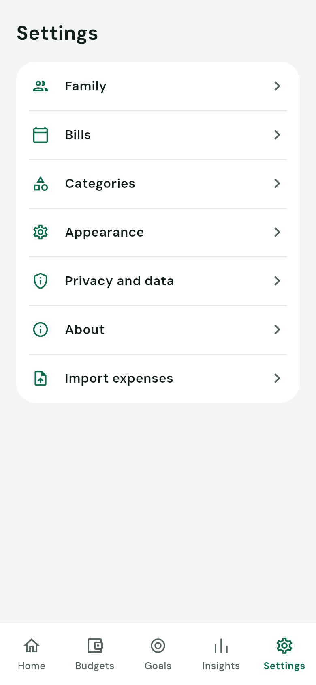<br>Settings | 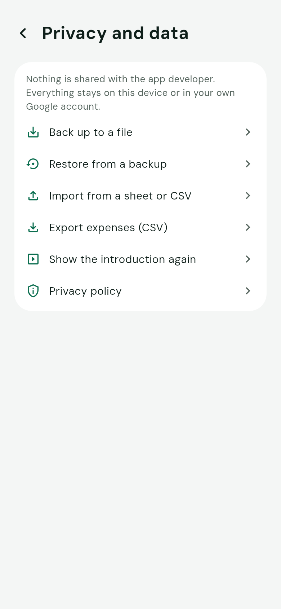<br>Privacy and data: backup, restore, import |
| 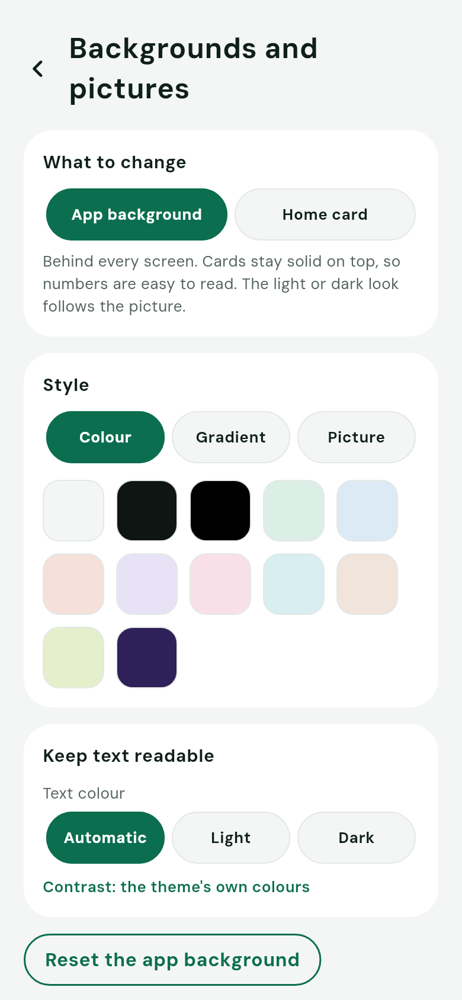<br>Backgrounds and pictures | 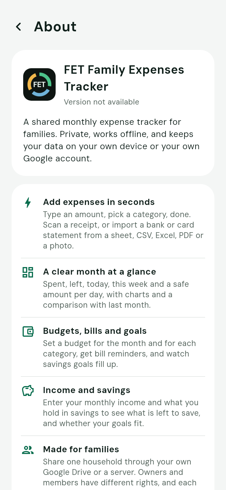<br>About | 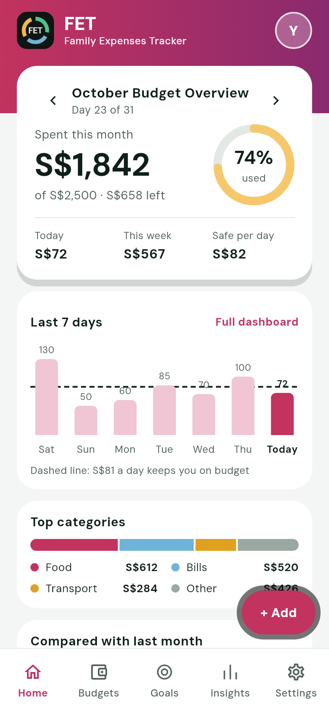<br>Rose colour theme |

<p align="center">
  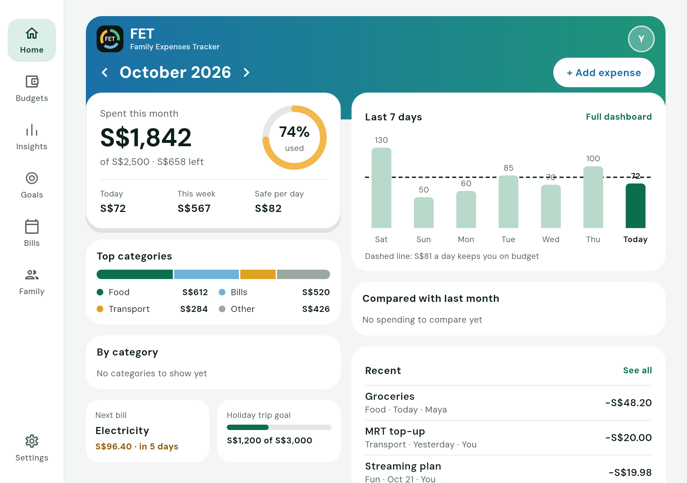
  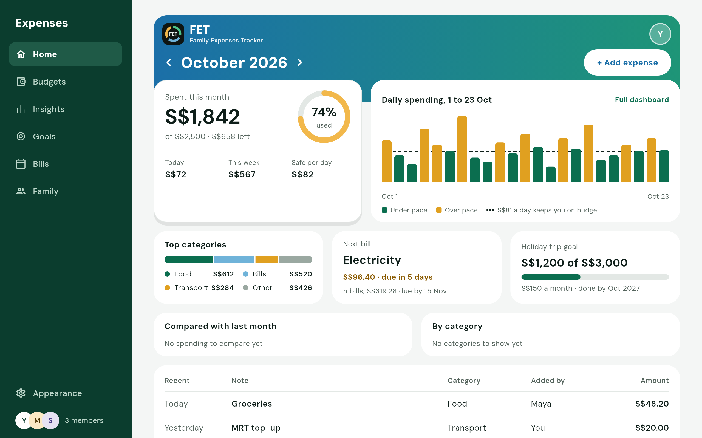
</p>

<p align="center">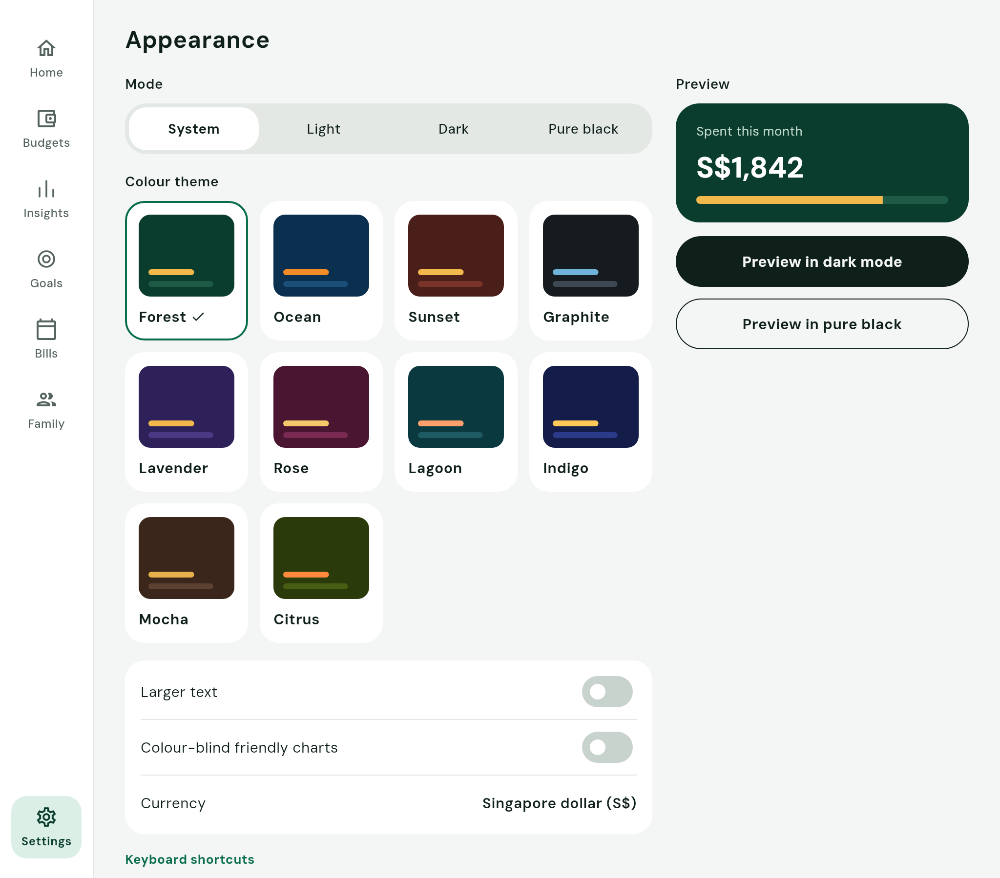</p>

The screenshots are made by the tests (`SCREENSHOTS=1 flutter test tests/screenshots`), so they always match the app. (Shadows look heavier in the test renderer than on a phone.)

## Where your data lives

| Mode | What it is | Needs |
|---|---|---|
| **Google Sheets** (default) | Your expenses are mirrored to Google Sheets in your own Drive. Family members join with a pairing code. Drive sharing is the access control. | A Google Cloud project, see [docs/GOOGLE_SETUP.md](docs/GOOGLE_SETUP.md) |
| **Server** | Accounts, households, roles and live sync through Supabase, with permissions enforced on the server. | A Supabase project |
| **Local** | One person, one device, nothing leaves it. | Nothing |

Choose with `--dart-define=BACKEND=sheets|supabase|local`. In every mode the app reads from a local database first, so it is fast and works offline. See the [privacy policy](docs/PRIVACY.md).

## Download

Every push to `main` builds Android and Windows on GitHub. Get a build from the **Releases** page (they are numbered `v0.0.1-dev1`, `v0.0.1-dev2`, and so on; take the highest): Android APK and Windows zip (macOS and Linux builds are paused for now; run the workflow by hand to get a dmg, tar.xz, deb and AppImage). Android needs "install from unknown sources"; keep the signing key from [docs/ANDROID_SIGNING.md](docs/ANDROID_SIGNING.md) so updates install over the old app.

## Build it yourself

You need [Flutter](https://docs.flutter.dev/get-started/install) (stable).

```bash
flutter pub get
flutter run                               # Google Sheets mode
flutter run --dart-define=BACKEND=local   # no accounts, no setup
flutter analyze && flutter test tests
scripts/build_test.sh                     # builds every target this machine supports into test/
```

Secrets (Supabase and Google keys) go in a git-ignored `.env.json` and are passed with `--dart-define-from-file=.env.json`. Never commit them. More in [docs/BUILD_AND_TEST.md](docs/BUILD_AND_TEST.md).

## Built with

Flutter and Dart, Riverpod, go_router, Drift (SQLite), fl_chart, Google Sheets and Drive APIs, Supabase (optional), ML Kit text recognition (on-device), local_auth, window_manager.

## Project layout

```
lib/core/       theme, layout (the only place that reads window width), money, database, sync
lib/features/   one folder per feature (expenses, budgets, goals, bills, family, import, backup, ...)
tests/          unit, widget and layout tests (run on every push)
docs/           design spec, build notes, Google setup, privacy policy, release notes
design/         the original mockups
```

Rules that keep the app consistent are in [CLAUDE.md](CLAUDE.md): one implementation per feature, money in integer cents, local first, tap targets of at least 44px, and charts that work for colour-blind people. The plan and the design tokens are in [PLAN.md](PLAN.md) and [docs/SPEC.md](docs/SPEC.md); what changed is in [CHANGELOG.md](CHANGELOG.md).

## Licence

No licence has been chosen yet, so the code is visible but not licensed for reuse. Open an issue if you would like to use it.
